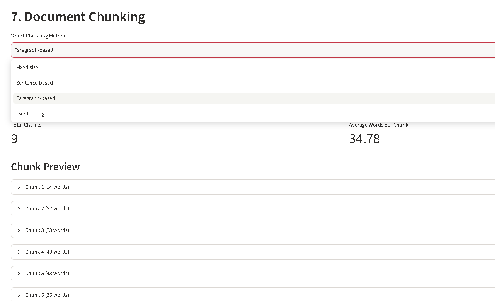
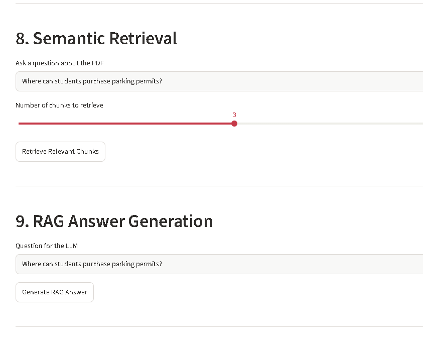
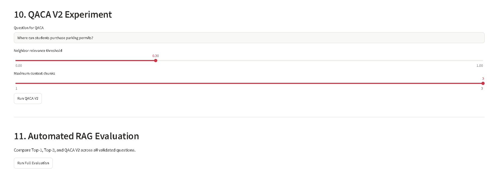
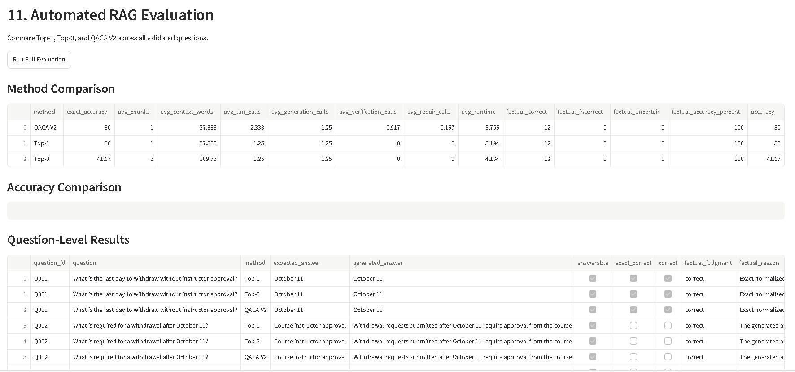

# Adaptive RAG Evaluation Platform

**An interactive research platform for benchmarking document chunking strategies and adaptive retrieval in Retrieval-Augmented Generation (RAG) systems.**

Built using Python, Streamlit, Sentence Transformers, Ollama, and Qwen2.5.

## Key Results

- **12 RAG configurations evaluated** across 4 chunking strategies and 3 retrieval approaches.
- **100% LLM-judged factual accuracy (12/12)** achieved by selected configurations on a synthetic university policy benchmark.
- **Approximately 61% less retrieved context** using QACA V2 compared with Top-3 retrieval under overlapping chunking, while improving evaluator-judged accuracy from 91.67% to 100%.
- Interactive performance comparisons tracking accuracy, context size, latency, and LLM calls.


## Application Screenshots

### 1. Document Chunking
Compare four chunking strategies and inspect the resulting document chunks.



### 2. Semantic Retrieval and Answer Generation
Retrieve relevant document chunks and generate grounded answers using a local LLM.



### 3. QACA V2 Adaptive Retrieval
Experiment with relevance thresholds, context expansion, and adaptive retrieval.



### 4. Automated RAG Evaluation
Compare retrieval methods using factual accuracy, context size, LLM calls, and runtime.




## Features

- PDF and CSV document uploads
- Four chunking strategies: paragraph, fixed-size, overlapping, and sentence
- Three retrieval methods: Top-1, Top-3, and QACA V2
- Semantic retrieval using `all-MiniLM-L6-v2`
- Local answer generation with `qwen2.5:3b`
- Evidence verification and adaptive context expansion
- Answer recovery for incomplete or unsupported responses
- Interactive benchmarking and performance visualizations

## Benchmark Results

The following results were obtained using 12 evaluation questions from a synthetic university policy handbook.

| Chunking | Retrieval | Factual Accuracy* | Avg. Context Words | Avg. Runtime |
|---|---|---:|---:|---:|
| Paragraph | QACA V2 | 100% | 37.6 | 3.04s |
| Paragraph | Top-1 | 100% | 37.6 | 1.82s |
| Paragraph | Top-3 | 100% | 109.8 | 2.21s |
| Fixed-size | QACA V2 | 91.67% | 109.4 | 3.74s |
| Fixed-size | Top-1 | 83.33% | 92.8 | 2.03s |
| Fixed-size | Top-3 | 91.67% | 271.0 | 2.95s |
| Overlapping | QACA V2 | 100% | 112.2 | 5.19s |
| Overlapping | Top-1 | 91.67% | 95.5 | 2.91s |
| Overlapping | Top-3 | 91.67% | 286.5 | 3.83s |
| Sentence | QACA V2 | 100% | 32.5 | 4.86s |
| Sentence | Top-1 | 100% | 30.7 | 2.86s |
| Sentence | Top-3 | 100% | 85.8 | 3.10s |

*Factual accuracy was assessed by an LLM evaluator, not independently verified human annotation.*

## How It Works

1. Upload a document.
2. Select a document chunking strategy.
3. Generate semantic embeddings.
4. Retrieve relevant evidence using Top-1, Top-3, or QACA V2.
5. Generate an answer using the local Qwen2.5 model.
6. Inspect evidence and compare evaluation metrics.

QACA V2 introduces adaptive retrieval with evidence checking, context expansion, and answer recovery.

## Installation

### Prerequisites

- Python and pip
- Ollama installed locally
- Qwen2.5 3B model

Download the model:

```bash
ollama pull qwen2.5:3b
```

Clone the repository:

```bash
git clone https://github.com/YOUR_USERNAME/adaptive-rag-evaluation-platform.git
cd adaptive-rag-evaluation-platform
```

Create and activate a virtual environment:

```bash
python -m venv .venv
```

Windows PowerShell:

```powershell
.\.venv\Scripts\Activate.ps1
```

Install dependencies:

```bash
python -m pip install -r requirements.txt
```

Run the application:

```bash
streamlit run app.py
```

Ensure Ollama is running locally before generating answers.

## Research Limitations

- Evaluation used a small synthetic dataset containing 12 questions.
- Results are specific to the tested document, prompts, model, and retrieval settings.
- Factual accuracy relies on LLM-based evaluation.
- Adaptive retrieval can increase latency and LLM calls.
- Additional documents, independent evaluation, and larger benchmarks are needed to establish generalizability.

## Technology Stack

**Python · Streamlit · Sentence Transformers · PyMuPDF · Pandas · PyTorch · Ollama · Qwen2.5**

## Research Focus

This project investigates how document chunking and retrieval strategies influence answer correctness, context efficiency, and inference cost in RAG systems.